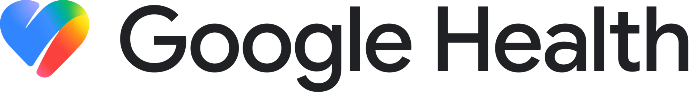

<p align="center">
  
</p>

# Google Health — Home Assistant (completa)

Substitui a integração **Google Health** do core (mesmo domínio `google_health`),
que só traz 15 sensores básicos, por uma versão que usa praticamente toda a
**Google Health API v4**: ~80 sensores em português, 2 calendários, serviços de
consulta livre e de registro (peso, água, refeição, exercício).

Ao instalar, ela **adota** a config entry, as credenciais OAuth e as entidades
que já existiam (mesmos `unique_id`), então nada precisa ser refeito.

> Não oficial, sem afiliação com o Google. Detalhes da API em
> [REVERSE_ENGINEERING.md](REVERSE_ENGINEERING.md).

## Instalação

1. Copie `custom_components/google_health` para `/config/custom_components/`
   (ou adicione o repositório no Marketplace/HACS como integração).
2. Reinicie o Home Assistant.
3. Se ainda não tinha a integração: Configurações › Dispositivos e serviços ›
   Adicionar › **Google Health**, com credenciais OAuth de um projeto do Google
   Cloud com a **Google Health API** ativada (tipo "Aplicativo da Web").
4. Para ECG, alertas de ritmo irregular e serviços de registro, aceite as
   permissões extras: Google Health › ⋮ › **Reconfigurar**. Enquanto não aceitar,
   aparece um aviso em Reparos e o resto funciona normalmente.

## Dispositivos e entidades

Uma conta vira sete dispositivos. Medições pontuais trazem `medido_em`
(dd/mm/aaaa HH:MM) e `fonte` (ex.: `Apple Watch (HEALTH_KIT)`) nos atributos.

### Google Health Atividade (hoje, fuso do HA)
Passos (atributo com os últimos 7 dias) · Passos ontem · Média de passos (7 dias) ·
Distância · Calorias ativas · Calorias totais · Calorias basais · Andares · Elevação ·
Minutos ativos (por intensidade) · Minutos em zona ativa (queima de gordura/cardio/pico) ·
Tempo sedentário · Tempo em zonas de FC · Calorias em zonas de FC

### Google Health Coração
Frequência cardíaca (última) · FC média hoje (mín/máx) · FC em repouso ·
Variabilidade da FC (diária; RMSSD no sono profundo, entropia) · VFC última medição ·
SpO2 (diária, faixa) · SpO2 última · Frequência respiratória · VO2 máx (nível de
condicionamento) · VO2 máx de corrida · Zonas de FC · Último ECG* · Alerta de ritmo irregular*

### Google Health Corpo
Peso · Altura · IMC · Gordura corporal · Temperatura corporal · Variação da
temperatura da pele (sono) · Glicose

### Google Health Sono (última noite principal; cochilos ignorados)
Tempo dormindo · Tempo na cama · Tempo acordado · Tempo para adormecer ·
Tempo na cama após acordar · Sono profundo / leve / REM · Despertares ·
Eficiência do sono · Início / Fim do sono · Média de sono (7 noites) ·
Respiração durante o sono · 📅 **Sono** (cada noite com fases e eficiência)

### Google Health Nutrição (hoje)
Água ingerida · Calorias consumidas · Carboidratos · Gorduras · Proteínas ·
Fibras · Açúcar · Sódio · Cafeína · Última refeição

### Google Health Exercícios
Último exercício (tipo em pt + duração, calorias, FC, distância, passos, ritmo,
elevação, GPS…) · Início / Duração / Calorias / FC média do último exercício ·
Exercícios, minutos e calorias nos últimos 7 dias · 📅 **Exercícios**

### Google Health Conta
Idade (perfil, passadas, unidades, fuso, IDs) · Membro desde · Aparelhos pareados ·
**Último dado recebido** (com `dias_sem_dados` — mostra se o app parou de sincronizar;
no iPhone, confira Ajustes › Saúde › Acesso a Dados e Dispositivos › Google Health).
Cada rastreador/balança Fitbit ou Pixel Watch pareado vira um dispositivo com
**Bateria** e **Última sincronização**.

\* só com a permissão de ECG/IRN.

## Serviços

| Serviço | O que faz |
|---|---|
| `google_health.buscar_dados` | Devolve (response) os data points crus de **qualquer** tipo num intervalo, ou o agregado diário. Ex.: `tipo: heart-rate, inicio: "2026-11-14 00:00"` |
| `google_health.registrar_peso` | Grava peso (e gordura opcional) — ex.: mandar a pesagem da balança do HA para o Google |
| `google_health.registrar_agua` | Grava água (mL) |
| `google_health.registrar_refeicao` | Grava alimento com kcal, carboidratos, gorduras, proteínas e refeição |
| `google_health.registrar_exercicio` | Grava sessão de exercício (tipo, duração, kcal, distância) |

Exemplo — balança → Google Health:

```yaml
automation:
  - alias: Peso da balança no Google Health
    trigger:
      - platform: state
        entity_id: sensor.balanca_corporal_peso
    condition: "{{ trigger.to_state.state | float(0) > 30 }}"
    action:
      - service: google_health.registrar_peso
        data:
          peso: "{{ trigger.to_state.state | float }}"
```

## Atualização

| Grupo | Intervalo |
|---|---|
| Atividade, coração, nutrição | 15 min |
| Corpo, sono, exercícios | 30 min |
| Conta e aparelhos | 6 h |

Os calendários consultam a API sob demanda, então mostram todo o histórico.

## Testes

```bash
uv run --with pytest pytest tests/test_parse.py          # parsers, sem HA
pytest tests                                            # com pytest-homeassistant-custom-component
```
